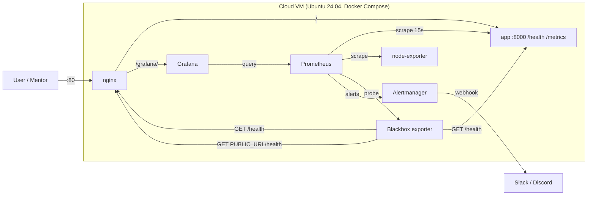
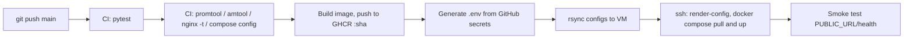

# Cloud Infrastructure Deployment & Monitoring Capstone

A containerized Flask service deployed to a cloud VM (AWS EC2, or DigitalOcean) with a full
monitoring stack: **Prometheus, Grafana, Alertmanager, Blackbox uptime probes, node-exporter**.
Deployment is automated end to end with GitHub Actions.

**Live application URL:** `http://<YOUR-PUBLIC-IP>`  <!-- fill in after deploying -->
**Grafana dashboard:** `http://<YOUR-PUBLIC-IP>/grafana/`  (user `admin`, password from your secret)

## Architecture



Only port 80 is public. Prometheus (9090) and Alertmanager (9093) are bound to `127.0.0.1` and reached
through an SSH tunnel. Cloud firewall (security group) and UFW allow only 22, 80, 443.

## CI/CD pipeline



| Workflow | Trigger | What it does |
|---|---|---|
| `.github/workflows/ci.yml` | PRs, pushes | Unit tests, Prometheus config and alert-rule tests, Alertmanager and Nginx validation, image build |
| `.github/workflows/deploy.yml` | push to `main` | Runs CI, builds and pushes the image tagged with the commit SHA, deploys over SSH, smoke tests the live URL |

**Automated environment variable configuration:** nothing is hand-edited on the server. The deploy job
generates `.env` from GitHub secrets/variables (`APP_ENV`, `APP_VERSION` = commit SHA, `APP_IMAGE`,
`PUBLIC_URL`, Grafana credentials, `SLACK_WEBHOOK_URL`). `scripts/render-config.sh` then renders the
public-URL probe target and the Alertmanager receiver from that `.env`.

## Repository layout

| Path | Purpose |
|---|---|
| `app/` | Flask service, `Dockerfile` (non-root, healthcheck, gunicorn) |
| `docker-compose.yml` | Whole stack on one VM |
| `nginx/default.conf` | Reverse proxy: gzip, rate limiting, `/grafana/` proxy |
| `monitoring/` | `prometheus.yml`, `alerts.yml`, `blackbox.yml`, targets |
| `grafana/` | Provisioned datasource and the "Capstone Overview" dashboard |
| `infra/` | `cloud-init.yaml`, `aws-ec2-launch.sh`, `aws-teardown.sh` |
| `scripts/` | `render-config.sh`, `smoke-test.sh` |
| `tests/` | `pytest` unit tests and `alerts_test.yml` (promtool rule test) |
| `docs/validation-output.txt` | Captured validation output |

## Deploy it

### 1. Provision the VM

**Option A: AWS EC2** (needs the AWS CLI configured and an SSH key; `ssh-keygen -t ed25519` if you have none)
```bash
./infra/aws-ec2-launch.sh ap-south-1 ~/.ssh/id_ed25519.pub
```
Creates a security group (22 from your IP only; 80/443 open), a `t3.small` Ubuntu 24.04 instance
bootstrapped by `cloud-init.yaml` (Docker, UFW, fail2ban, key-only SSH, `deploy` user), and an
Elastic IP. It prints the IP and the secrets to set. Teardown: `./infra/aws-teardown.sh ...`.

**Option B: DigitalOcean**
```bash
sed "s|SSH_PUBLIC_KEY_PLACEHOLDER|$(cat ~/.ssh/id_ed25519.pub)|" infra/cloud-init.yaml > /tmp/ci.yaml
doctl compute droplet create cloud-capstone --image ubuntu-24-04-x64 --size s-1vcpu-2gb \
  --region blr1 --user-data-file /tmp/ci.yaml --wait
```
Then add a Cloud Firewall allowing inbound TCP 22, 80, 443 only.

Wait about 2 minutes for cloud-init, then check `ssh deploy@<IP> "docker --version"`.

### 2. Add GitHub Actions secrets
Repo > Settings > Secrets and variables > Actions:

| Secret | Value |
|---|---|
| `SSH_HOST` | VM public IP |
| `SSH_USER` | `deploy` |
| `SSH_PRIVATE_KEY` | contents of your private key (`~/.ssh/id_ed25519`) |
| `PUBLIC_URL` | `http://<IP>` (or your https domain) |
| `GRAFANA_ADMIN_PASSWORD` | a strong password |
| `SLACK_WEBHOOK_URL` | optional Slack/Discord incoming webhook for alerts |

Optional repository **variables**: `APP_MESSAGE`, `ENABLE_DEMO_ENDPOINTS`.

### 3. Deploy
`git push origin main`. The **Deploy** workflow runs. When it finishes:
```bash
./scripts/smoke-test.sh http://<IP>
```

## Monitoring and alerting

**Uptime monitoring:** the Blackbox exporter probes `/health` three ways (app directly, via nginx, and
via the **public URL**) every 15 s. `probe_success` drives the "Public endpoint up" panel and alerts.

| Alert | Condition | Severity |
|---|---|---|
| `TargetDown` | any scrape target `up == 0` for 1 m | critical |
| `EndpointDown` | health probe failing for 1 m | critical |
| `HighErrorRate` | more than 5% 5xx for 2 m | warning |
| `HighLatencyP95` | p95 above 1 s for 5 m | warning |
| `HighCPU` | host CPU above 85% for 10 m | warning |
| `LowDiskSpace` | under 15% free on `/` for 5 m | warning |

Alertmanager groups and routes alerts to Slack when `SLACK_WEBHOOK_URL` is set; otherwise they are visible
in the Alertmanager UI.

**Prove alerting works (for the mentor demo):**
```bash
ssh deploy@<IP> "cd ~/capstone && docker compose stop app"     # EndpointDown + TargetDown fire in ~1-2 min
ssh deploy@<IP> "cd ~/capstone && docker compose start app"    # alerts resolve
```
Set `ENABLE_DEMO_ENDPOINTS=true` to also expose `/error` (always 500) and `/slow?ms=2000` for the error and latency alerts.

**Private UIs via SSH tunnel:**
```bash
ssh -L 9090:127.0.0.1:9090 -L 9093:127.0.0.1:9093 deploy@<IP>
# Prometheus http://localhost:9090/alerts   Alertmanager http://localhost:9093
```

## Using your own application
Replace `app/` with your service. It must listen on port 8000, return 200 on `GET /health`, and
optionally expose Prometheus metrics at `/metrics`. Update the app-specific dashboard queries if your
metric names differ.

## Security notes
- Docker-published ports **bypass UFW**, so only nginx publishes a port; internal services bind to `127.0.0.1`.
- Secrets live only in GitHub Actions and the server's `.env` (gitignored); the container runs as non-root.
- SSH is key-only, root login is disabled, fail2ban is installed, and the AWS security group limits SSH to your IP
  (update it if your IP changes).
- For HTTPS, point a domain at the VM and reuse the TLS setup from the `secure-linux-nginx` repo, then set `PUBLIC_URL=https://...`.

## Validation performed
See `docs/validation-output.txt`: unit tests, `promtool` config and rule checks, an alert rule unit test,
`amtool`, `nginx -t`, and a live run of the app and its metrics. `docker compose up` and the cloud
deployment itself must be done in your own account.

## Submission checklist
- [ ] Repo pushed to GitHub with CI passing (green check on `main`)
- [ ] Deploy workflow succeeded (screenshot or link to the run)
- [ ] Live URL responds: `http://<IP>/health` returns `{"status":"ok"}`
- [ ] Grafana dashboard screenshot showing live data
- [ ] Alert demo: screenshot of `EndpointDown` firing in Prometheus or Slack
- [ ] Live URL and repo link filled in at the top of this README

## Cost and cleanup
A `t3.small` plus an Elastic IP costs a few dollars per month. Run `infra/aws-teardown.sh` (or delete the
droplet) after evaluation to stop charges.
